# GUI guide — `ads1299-gui`

Python EVM client with **SLAU443B LabVIEW functional parity**: registers, lead-off poll, scope / FFT / histogram / analysis, impedance presets, and save.

```bash
pip install -e ".[gui]"
ads1299-gui
```

Screenshots below are documentation renders that mirror the live Tk window (`scripts/render_gui_doc_pages.py`). Re-capture live window shots with `scripts/capture_gui_screenshots.py` after granting Screen Recording to the terminal / Cursor Computer Use.

---

## Window chrome

| Control | Role |
|---------|------|
| **Connect** | Detect bootloader or Styx, load firmware if needed, open 9P session |
| **Disconnect** | Close USB / Styx session |
| **Read Registers** | Refresh all `/ads1299evm/conf/*` values into widgets + Register Map |
| **Show/Poll Lead-Off** | Dialog polling `loffstatp` / `loffstatn` every 500 ms |
| Progress bar | Firmware load / acquire progress |
| Status line | Connection, last write, acquire / stream messages |

---

## Pages

### 1. About

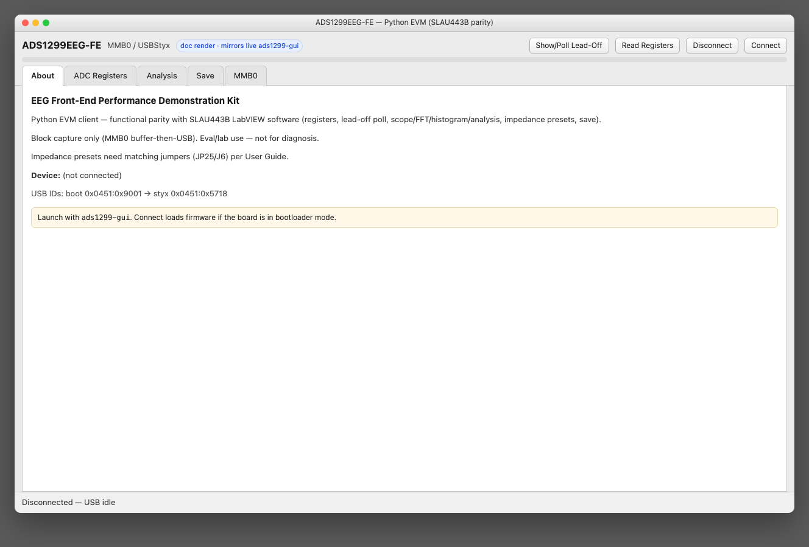

Product intro, eval disclaimer, USB ID table (`0451:9001` → `0451:5718`), connection summary.

### 2. ADC Registers → Global

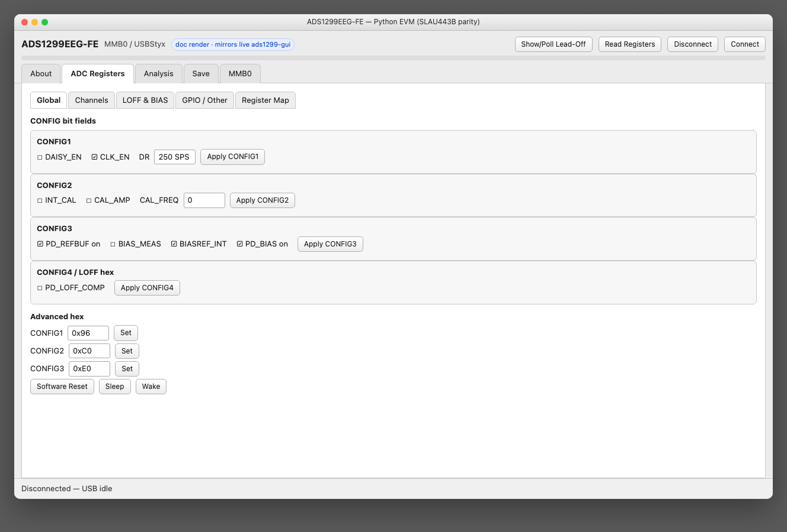

Bit-field editors for CONFIG1–4 (DR, INT_CAL, bias/refbuf, LOFF comparator power) plus advanced hex Set and Soft Reset / Sleep / Wake.

### 3. ADC Registers → Channels

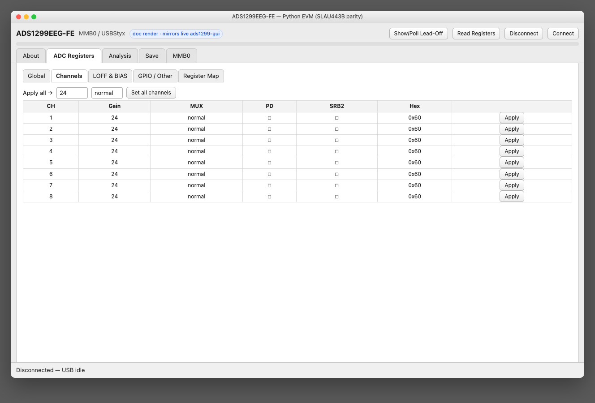

Per-channel Gain / MUX / PD / SRB2 and “Set all channels”. Writes `chNset` via Styx.

### 4. ADC Registers → LOFF & BIAS

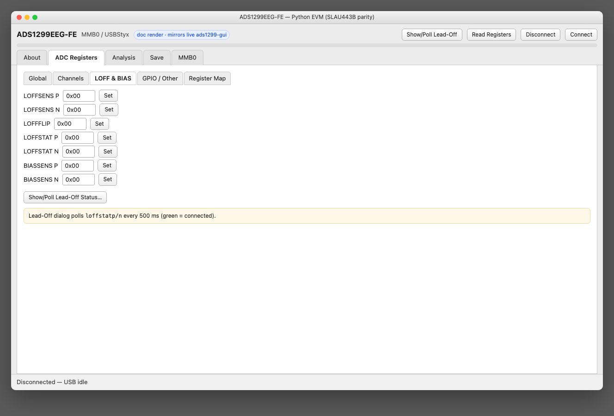

Lead-off sense / flip / status and bias sense hex controls; opens the lead-off poll dialog.

### 5. ADC Registers → GPIO / Other

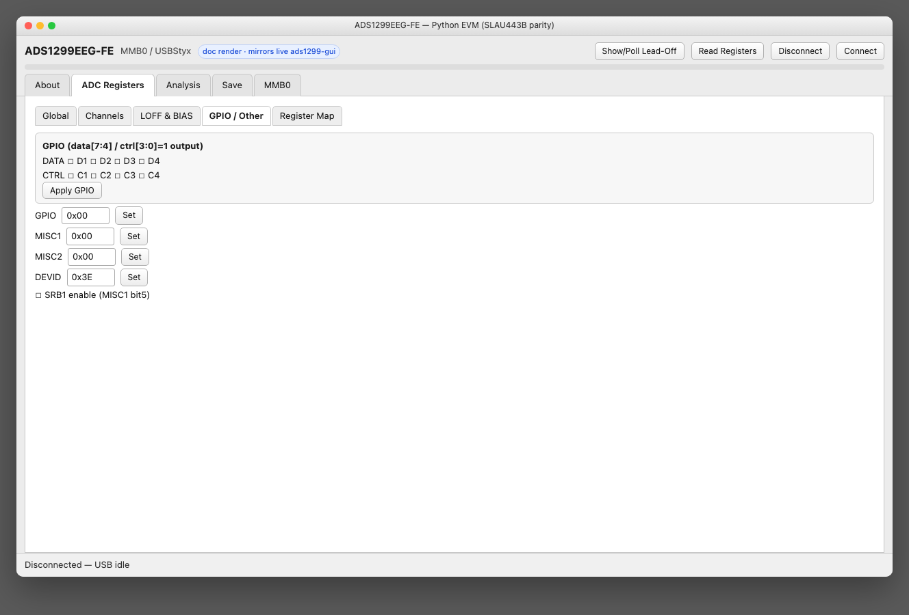

GPIO data/ctrl bits, MISC1/2, DEVID, SRB1 (MISC1 bit5).

### 6. ADC Registers → Register Map

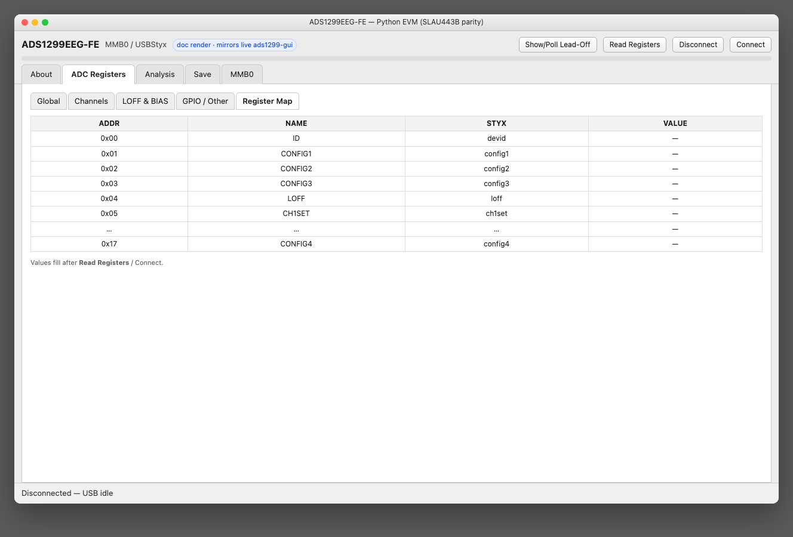

Tabular addr / name / styx path / live value after Read Registers.

### 7. Analysis → Scope

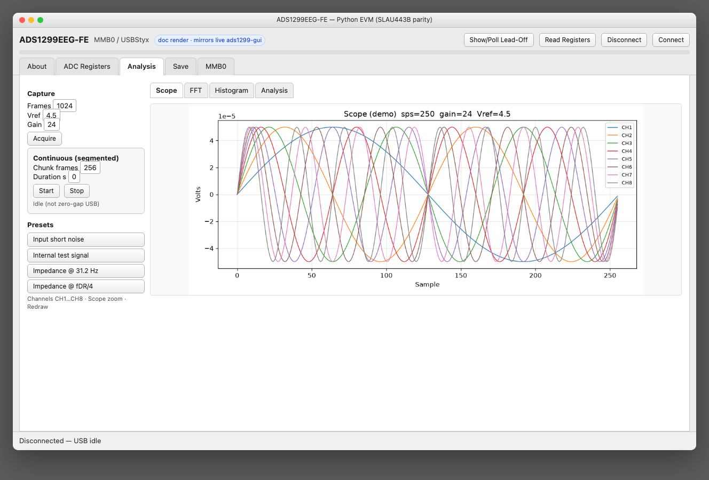

Block **Acquire**, segmented continuous Start/Stop, SLAU443B-style presets, channel visibility, scope zoom. Demo sine wave until a live capture.

### 8. Analysis → FFT

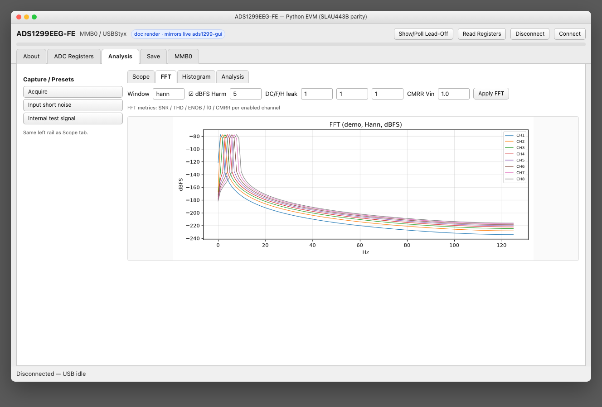

Window, dBFS, harmonic / leakage bins, CMRR Vin; SNR / THD / ENOB / f0 metrics per enabled channel.

### 9. Analysis → Histogram

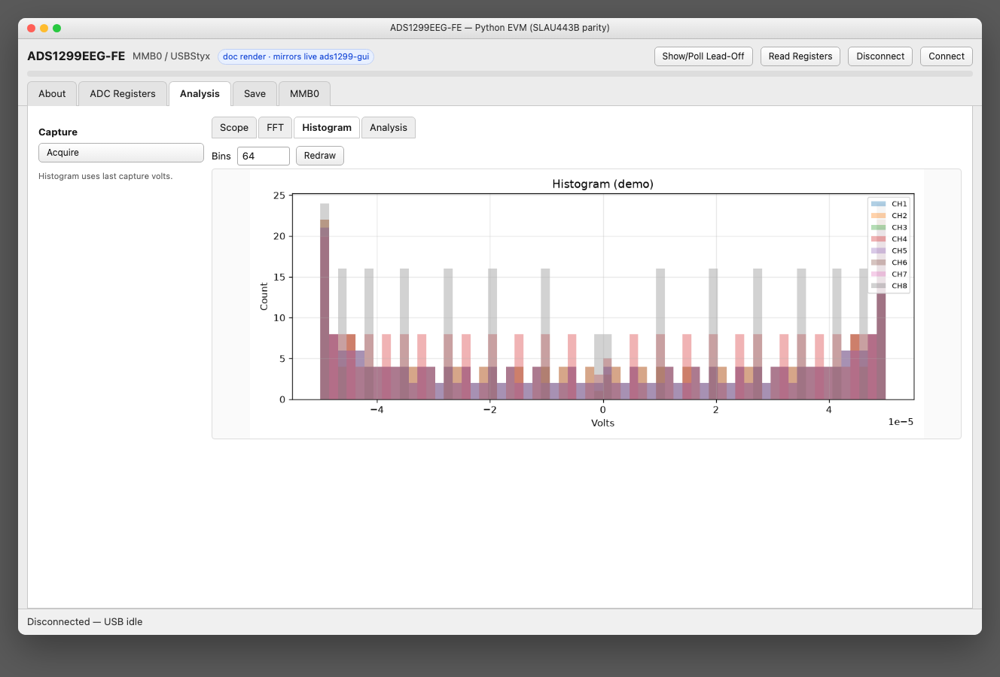

Amplitude histogram of the last capture (bin count adjustable).

### 10. Analysis → Analysis

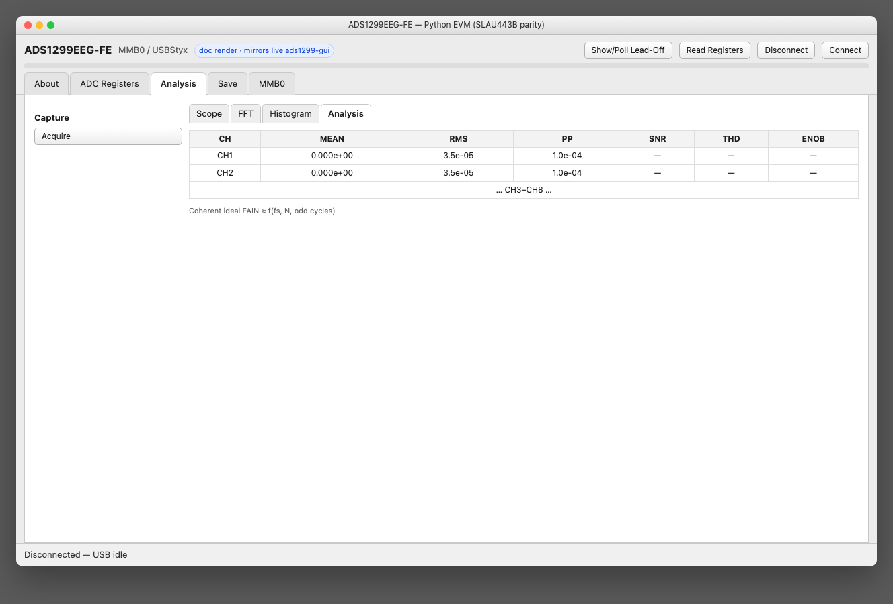

Mean / RMS / peak-peak plus AC metrics table; coherent ideal FAIN hint for FFT-friendly frame counts.

### 11. Save

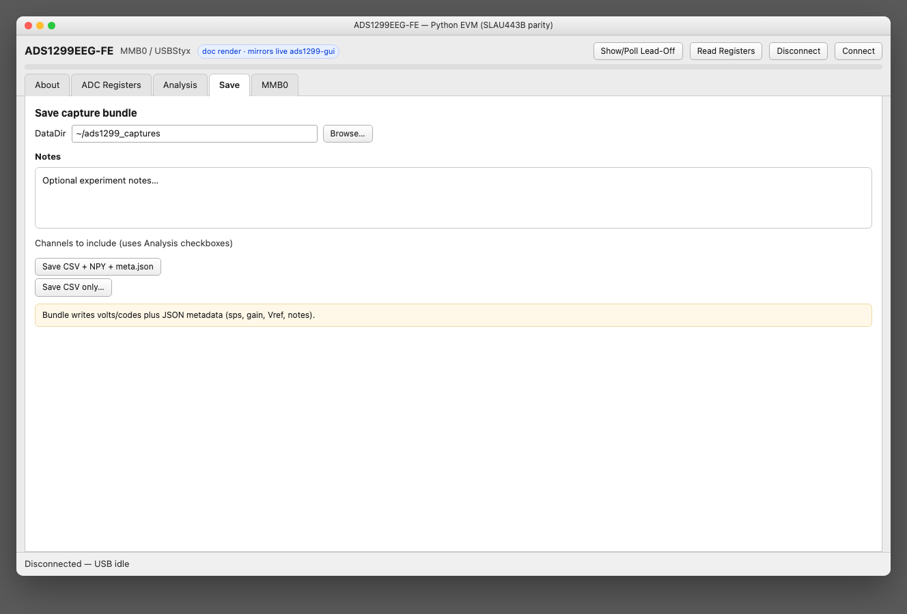

Write CSV + NPY + `meta.json` bundle (or CSV only) under a chosen DataDir, with free-form notes.

### 12. MMB0

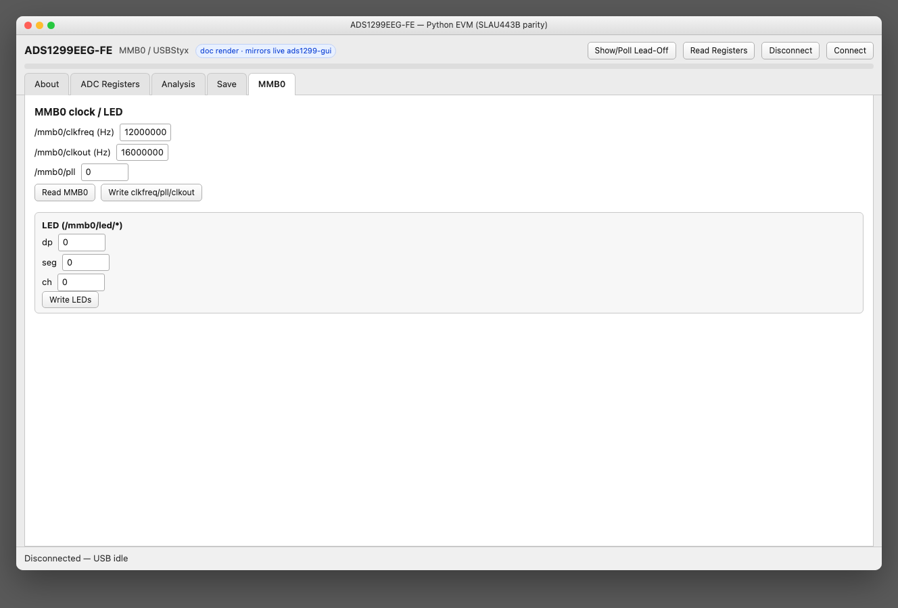

Read/write `/mmb0/clkfreq`, `/mmb0/clkout`, `/mmb0/pll`, and LED paths under `/mmb0/led/*`.

---

## Standalone plot assets

| File | Source |
|------|--------|
| [plot-scope-demo.png](gui_screenshots/plot-scope-demo.png) | Same demo waveform the GUI shows at startup |
| [plot-fft-demo.png](gui_screenshots/plot-fft-demo.png) | Hann / dBFS FFT of demo |
| [plot-hist-demo.png](gui_screenshots/plot-hist-demo.png) | Histogram of demo |

See also [WORKFLOWS.md](WORKFLOWS.md) and [HARDWARE.md](HARDWARE.md).
