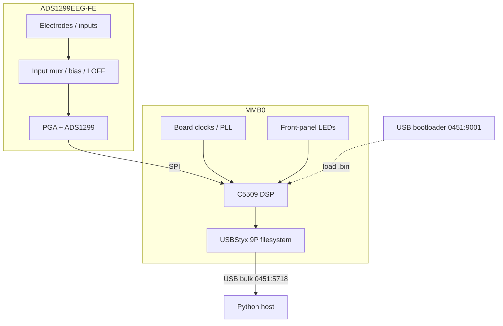

# Hardware context

TI **ADS1299EEG-FE** daughterboard on **MMB0**. Obtain jumpers, clock, and full schematics from the official [ADS1299EEGFE-PDK](https://www.ti.com/tool/ADS1299EEGFE-PDK) User Guide / schematic package (TI copyright — not redistributed here).

Local cropped UG captures (if you extracted them yourself) can live under `docs/schematic_captures/` and stay **gitignored**.

## Signal / control path

## USB identity

| State | VID:PID | Role |
|-------|---------|------|
| Bootloader | `0451:9001` | Accepts `ads1299evm-pdk.bin` |
| USBStyx | `0451:5718` | 9P over bulk — registers, data, `/mmb0/*` |

## Jumpers that matter for GUI presets

| Topic | GUI impact |
|-------|------------|
| Factory default | Input-short / internal-test presets |
| JP25 / J6 (impedance) | Required for **Impedance @ 31.2 Hz** and **Impedance @ fDR/4** presets — match User Guide |

Exact jumper tables: TI User Guide (do not rely on this repo for PCB truth).

## MMB0 Styx paths (GUI tab)

| Path | GUI control |
|------|-------------|
| `/mmb0/clkfreq` | Clock frequency (Hz) |
| `/mmb0/clkout` | Clock out (Hz) |
| `/mmb0/pll` | PLL |
| `/mmb0/led/dp`, `seg`, `ch` | LED writes |

See [WORKFLOWS.md](WORKFLOWS.md) and [GUI.md](GUI.md).
