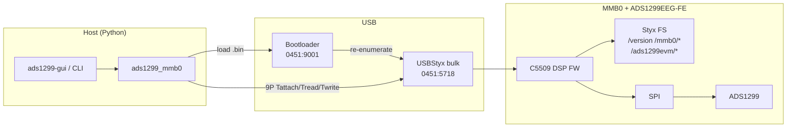
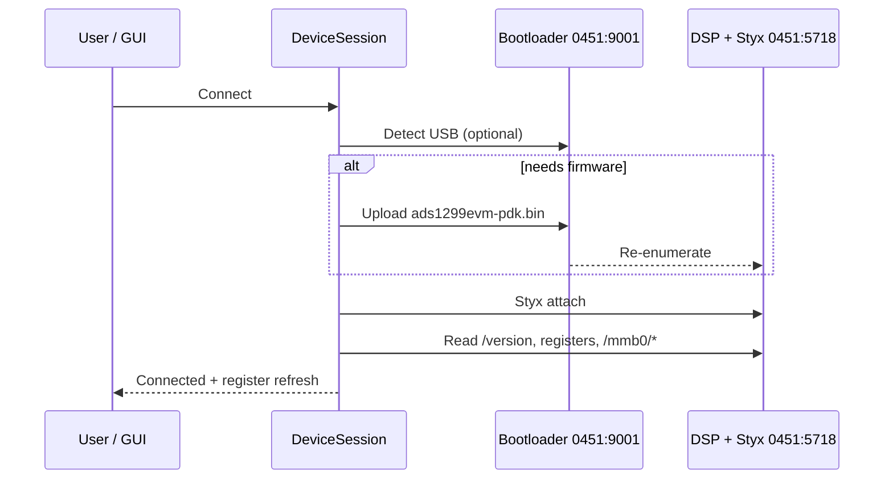
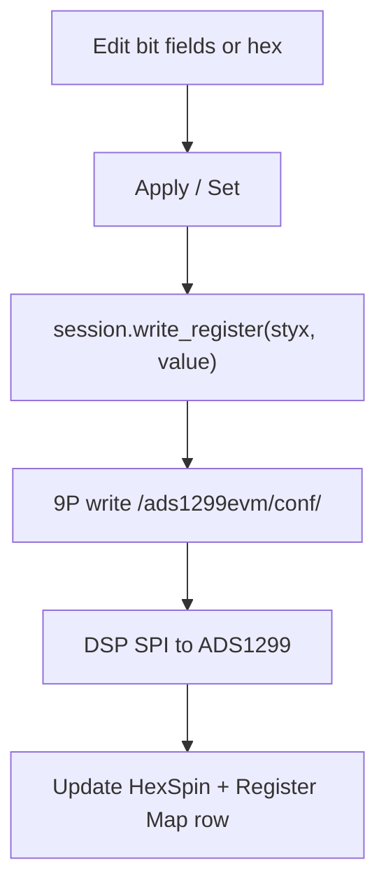
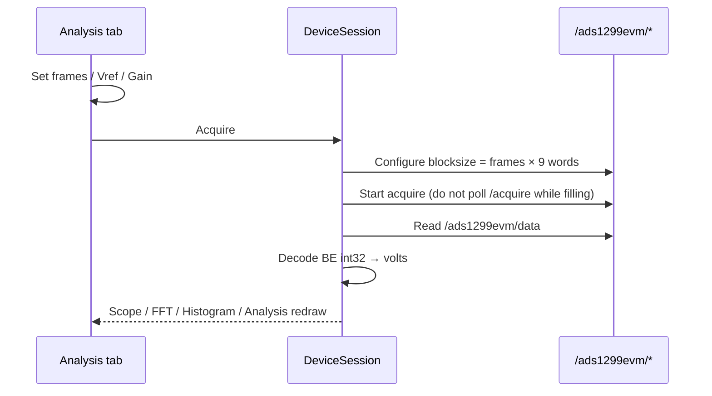
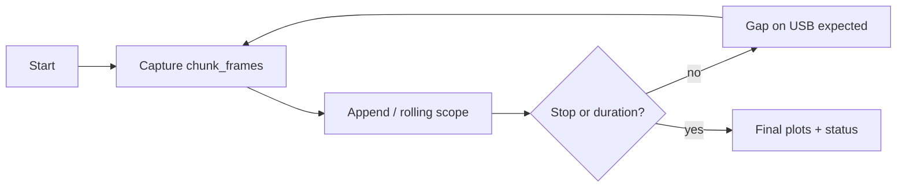
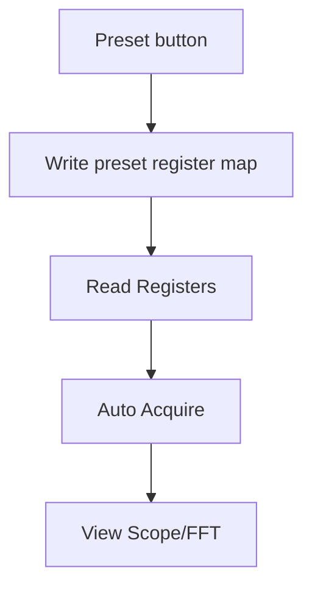
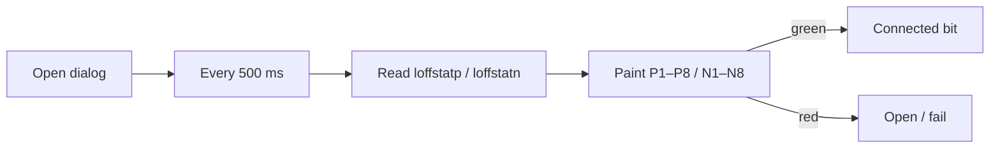
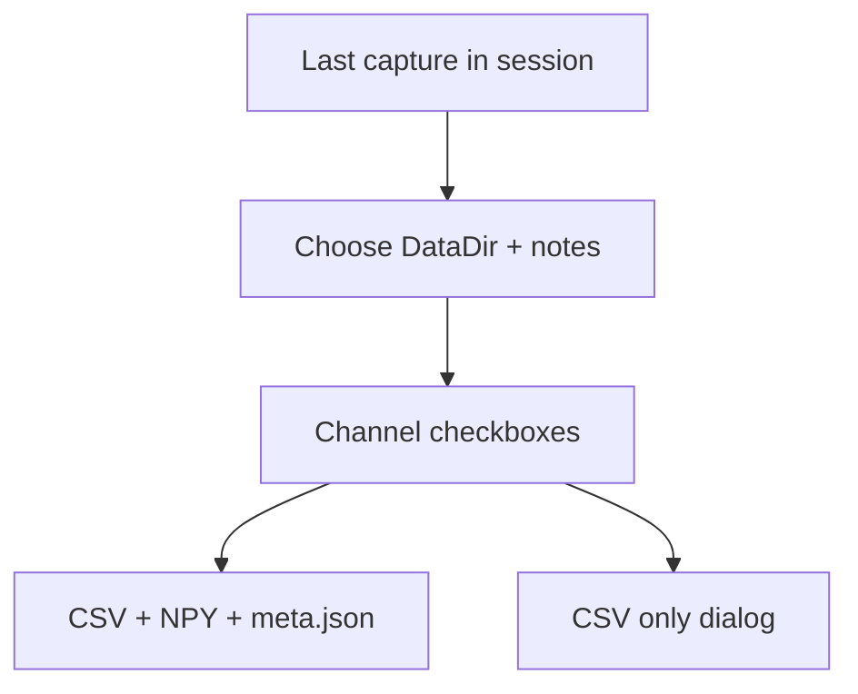
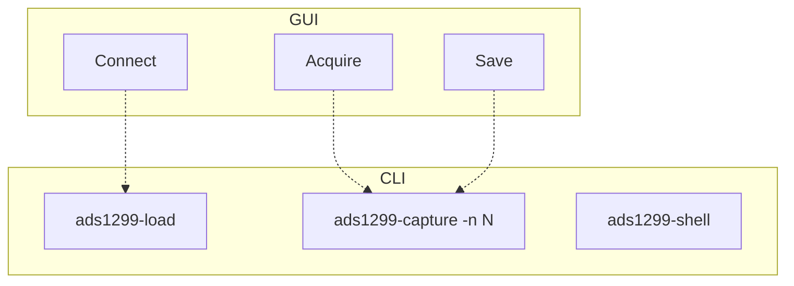

# Workflows

Host-side control plane: **USB bootloader → DSP firmware → USBStyx (9P) → ADS1299 registers / data**. The PC never drives SPI directly.

## System architecture



## Connect / firmware load



**CLI:** `ads1299-load --wait -f "$ADS1299_FIRMWARE"` then `ads1299-gui` or `ads1299-shell --no-load`.

If bulk USB wedges after a bad acquire: power-cycle the MMB0 wall wart, wait for `0451:9001`, load again.

## Register write



Global CONFIG packing helpers live in `presets.pack_config*`; channel packing in `registers.chset`.

## Block acquire (primary path)

Stock firmware is **buffer-then-USB** (~1 MB ≈ ~28k frames).



**Important (FW 0.0.27):** `blocksize` is int32 **word** count and must be `9 * n_frames` (status + 8 channels). Word counts not divisible by 9 hang the DSP.

## Segmented continuous capture



Not zero-gap streaming. True continuous needs custom DSP firmware (out of scope).

## Presets (SLAU443B-style)



| Preset | Intent |
|--------|--------|
| Input short noise | All CH MUX=short, refbuf on, 250 SPS |
| Internal test signal | CONFIG2 INT_CAL + MUX=test |
| Impedance @ 31.2 Hz | AC lead-off FLEAD=31.2 Hz (needs JP25/J6) |
| Impedance @ fDR/4 | AC lead-off at fDR/4 (250 SPS → 62.5 Hz) |

## Lead-off poll



## Save bundle



## CLI equivalents



```bash
export ADS1299_FIRMWARE=/path/to/ads1299evm-pdk.bin
ads1299-load --wait -f "$ADS1299_FIRMWARE"
ads1299-capture -n 64 -o out.bin --npy out.npy
ads1299-gui
```

## Library acquire sketch

```python
from ads1299_mmb0 import ADS1299
from ads1299_mmb0.stream import acquire_continuous

with ADS1299.open() as dev:
    print(dev.read_path("/version"))
    volts = dev.acquire(n_samples=64)  # (64, 8) float volts
    long = acquire_continuous(dev, total_frames=8192, chunk_frames=4096)
```
